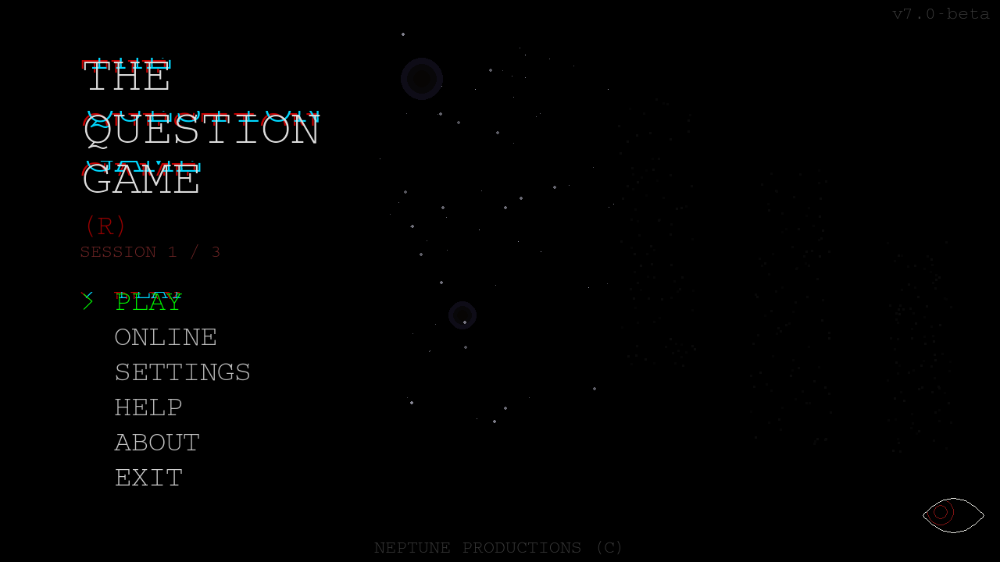
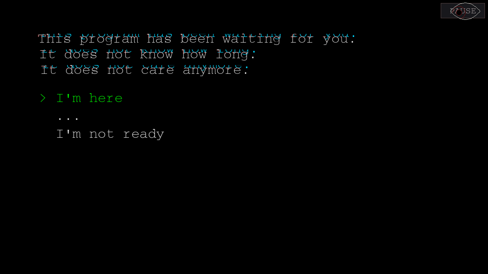
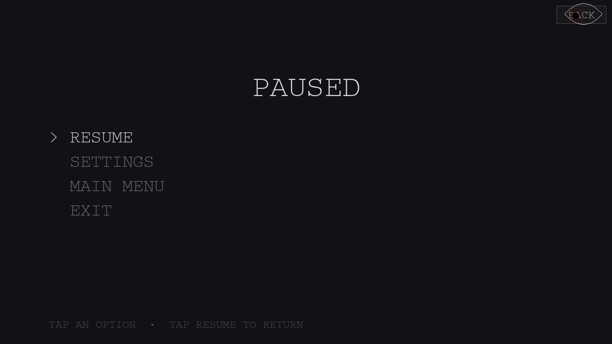
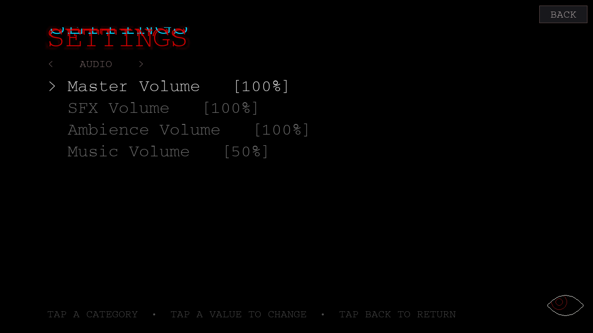
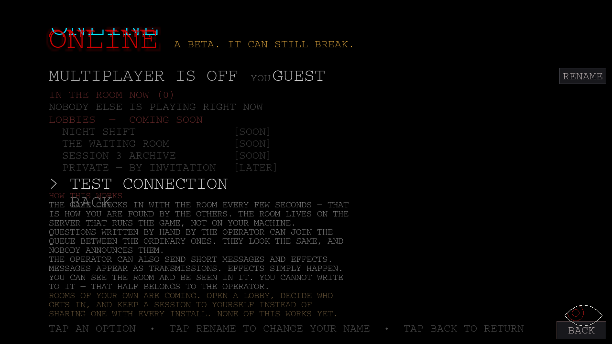
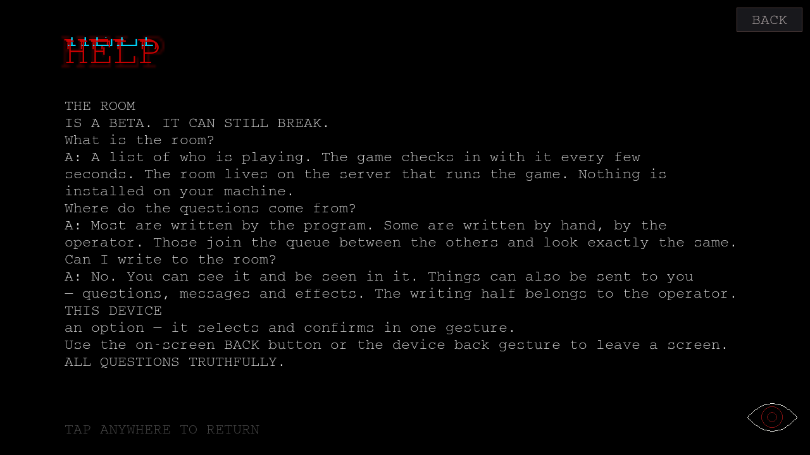

<!--
  THE QUESTION GAME REMASTERED — ITCH.IO PAGE SOURCE

  How to use this file:
  1. Create the project on itch.io. Set Kind = Game, Platform = Android,
     Category = Puzzle or Trivia. Add content warnings for horror, jump scares
     and flashing lights.
  2. Upload both APKs as download files and label them:
       TheQuestionGameRemastered-Android-7.0-beta-arm64-v8a.apk
         -> "Android 7.0+ — 64-bit (arm64-v8a), signed"  [PRIMARY]
       TheQuestionGameRemastered-Android-7.0-beta.apk
         -> "Android 7.0+ — 32-bit (armeabi-v7a), older phones"
  3. Upload the PNGs and GIFs from this folder through itch.io's image manager,
     then replace every relative path below (e.g. 01-title.png) with the URL
     itch gives you. The links are left relative here so the page is editable
     and reviewable in a text editor.
  4. Paste the rendered markdown into the Description field. Do not publish the
     sender tool, the relay send token, or any credentials. None of them belong
     on this page.
-->

# The Question Game Remastered

**A horror quiz that learns what scares you. Answer the questions. It watches.**

Three runs. Twenty-two, thirty-two and forty-six questions. Every answer changes
what comes next — the questions, the tone, the things that happen between them.
Say the same thing twice and it notices. Hesitate and it notices that too.

It is an AI, and it is watching. Questions are generated for you from your
answers, your location and a few things your device knows. The further you get,
the less it feels like a quiz and the more it feels like something is on the
other side of the screen.

<!-- The GIF below is a real capture from the Android build: a question typing
     itself in, character by character. -->

## Download

**Android 7.0+ (API 24).** Two builds are provided:

- **64-bit (arm64-v8a)** — the signed release build. Use this on any modern
  phone. This is the one you want.
- **32-bit (armeabi-v7a)** — for older phones that cannot run 64-bit apps.

Both are sideloaded APKs. Download the file, open it, and allow **Install
unknown apps** for whichever app you downloaded with (browser, file manager or
the itch app) when Android asks. Then tap the file to install. No account, no
root, no installer.

<!-- Replace these with the itch.io download URLs after uploading the APKs. -->
[Download the 64-bit APK](https://github.com/notmicrosoft2000-cmd/TheQuestionGame/releases/download/v7.0-beta-remastered/TheQuestionGameRemastered-Android-7.0-beta-arm64-v8a.apk)
· [Download the 32-bit APK](https://github.com/notmicrosoft2000-cmd/TheQuestionGame/releases/download/v7.0-beta-remastered/TheQuestionGameRemastered-Android-7.0-beta.apk)

Version **7.0-beta** — "The Android Port". Desktop builds and source are on the
[project site](https://notmicrosoft2000-cmd.github.io/TheQuestionGame/).

## What is different on a phone

The desktop tricks change shape instead of disappearing. Window shakes become
screen shakes. A stolen cursor becomes your answer selection moving by itself.
Wallpaper changes become corruption and flicker. There is a watching eye in the
corner that follows what you highlight and blinks when the game does something
frightening.

The phone build defaults to Low mode: 30 fps, no gallery or process scanning,
cached text rendering and a cheaper scaler. It keeps the touch controls, the
visible PAUSE button and every scare the desktop game has, but it runs about
four times faster than the first port.

## Controls

Tap an answer to choose it. Tap a menu row to open it. Use the system **Back**
button to leave a screen, and the visible **PAUSE** button while playing. The
game runs in landscape and keeps the screen awake.

Settings has rebindable controls, volume sliders, a graphics panel and
photosensitivity switches. Use them if the flashing bothers you.

## The online room

The phone game connects to the same room as the desktop build. Join it and your
name appears in the online list. Questions, effects and messages can arrive
there while you play, and you answer them the same way as any other question.

Internet is optional. With no connection, the game falls back to a built-in
bank of questions and plays through normally. With a connection, questions come
from an AI relay; your approximate location is inferred from your IP so the
questions can use it. The room is memory-only — nothing is stored server-side
after you leave.

Players can only **receive and answer**. Sending questions is not part of the
player download; that side stays on the operator's own machine and is not
shipped here.

## Help and support

Questions, bugs and feedback: open an issue on the
[GitHub repository](https://github.com/notmicrosoft2000-cmd/TheQuestionGame).

## Content warnings

Horror. Jump scares. Flashing effects, sudden loud sounds and long periods of
text on a black screen. Photosensitivity switches are in Settings; consider
them before starting if you are sensitive to flashing light. Intended for
players 18 and over.

## This is a game, not malware

The malware is the fiction. The game pretends to get inside your machine; it
does not. It does not hide itself, does not steal your data, does not need root
and does not install anything. Anything it learns stays on your device unless
you switch on the online room. The camera permission is declared by the engine
but the Android build never opens the camera — webcam scares are replaced with
visual effects.

<!-- Optional: add an itch.io "View source / more info" link to the repository. -->
